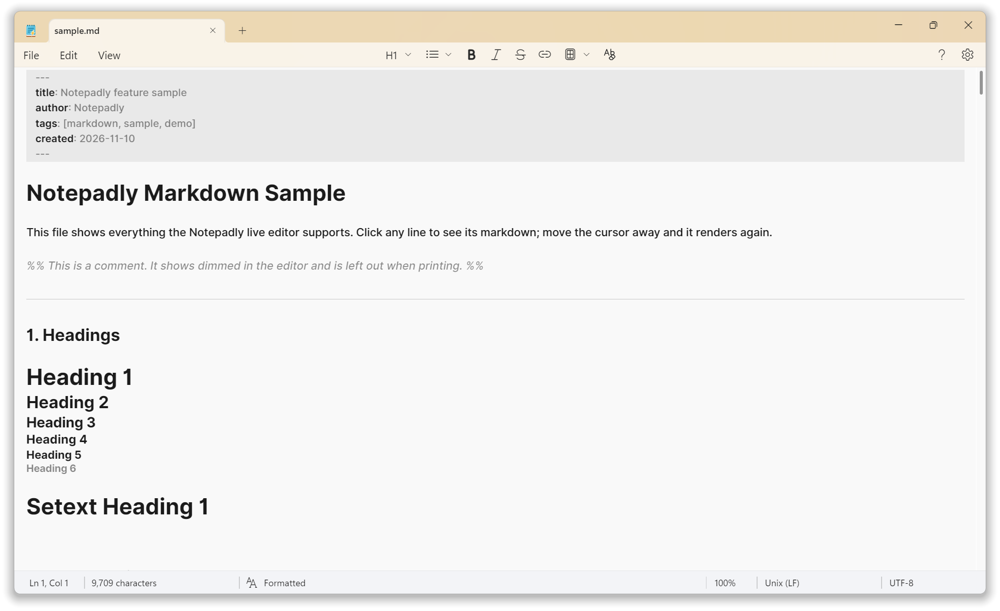
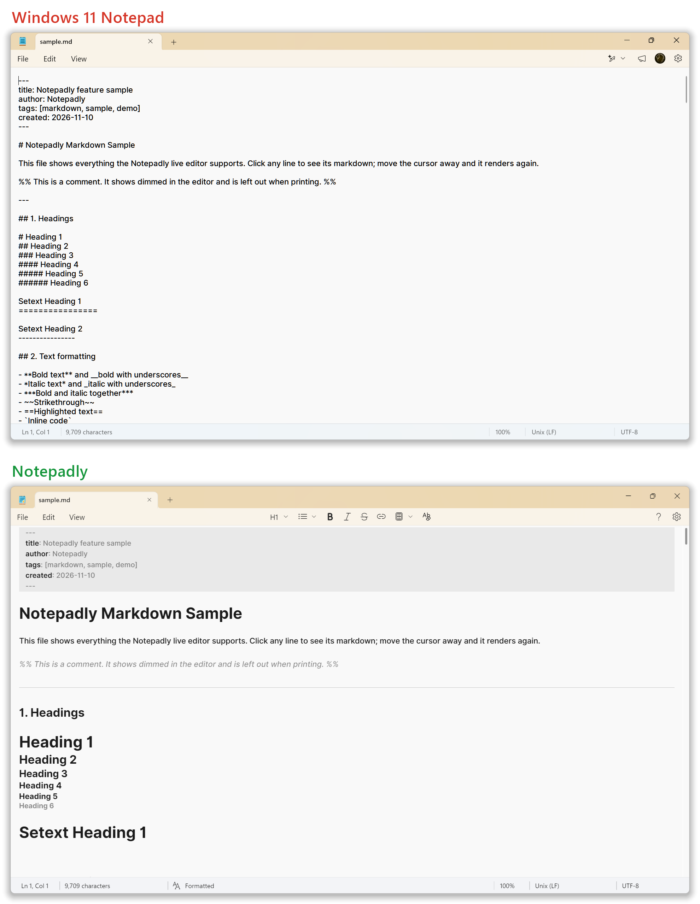
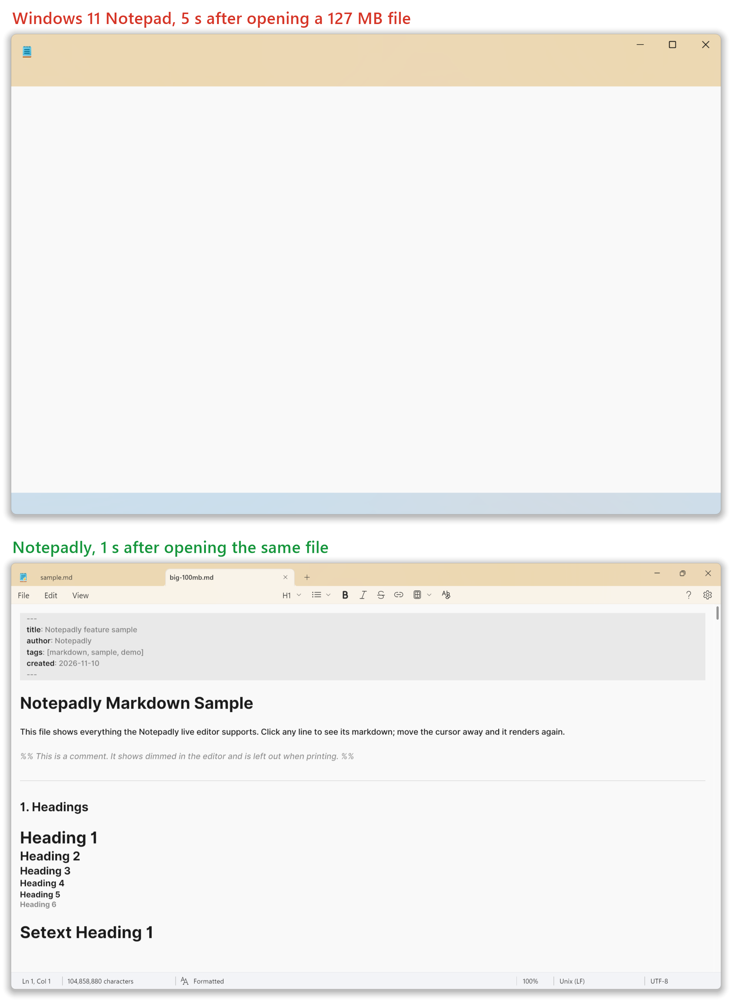
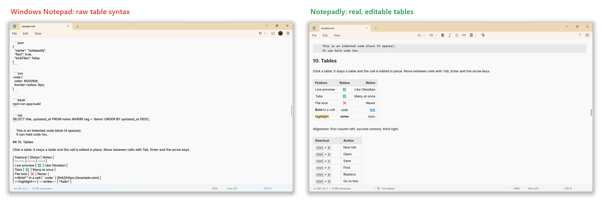
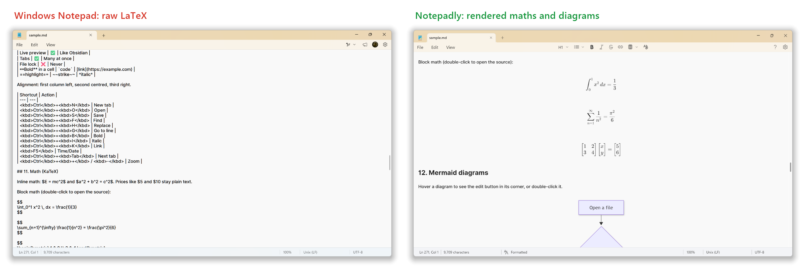
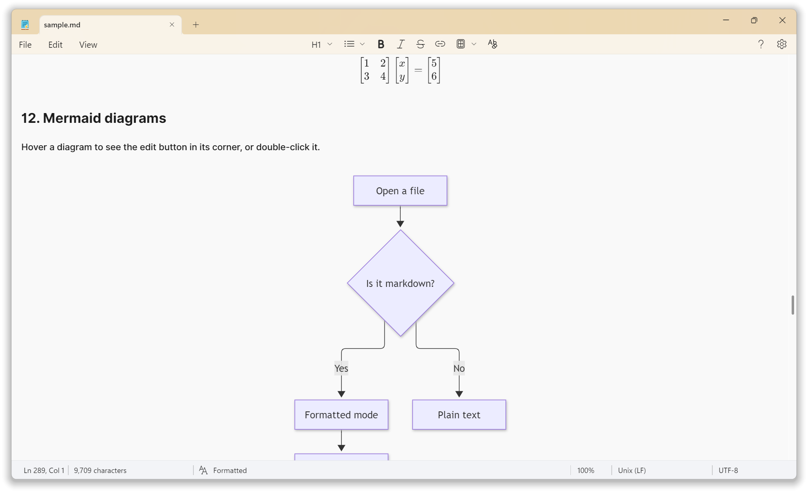
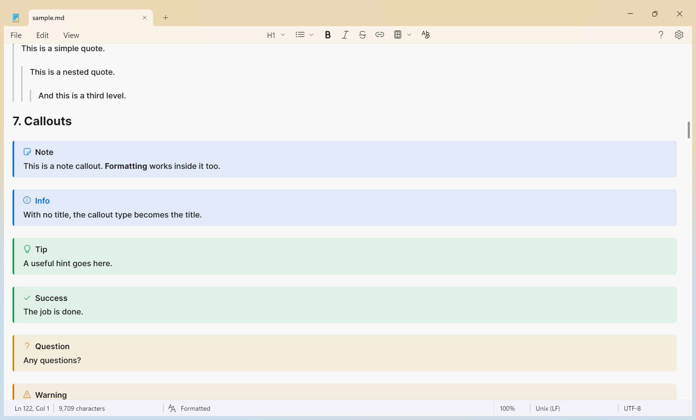
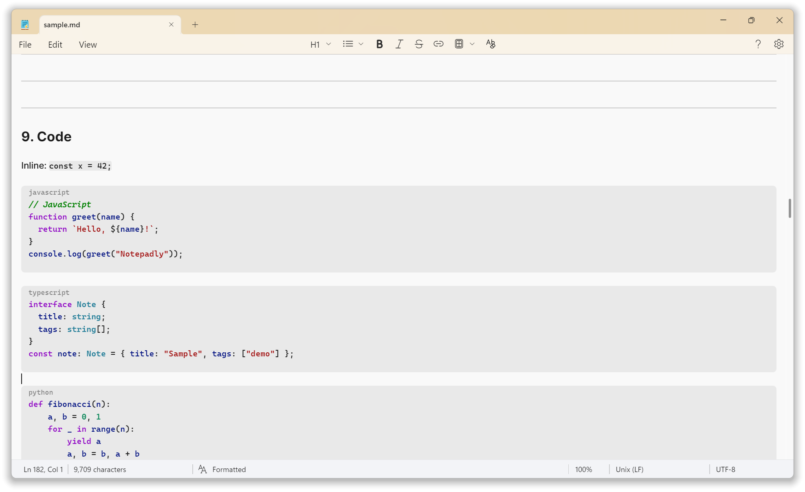
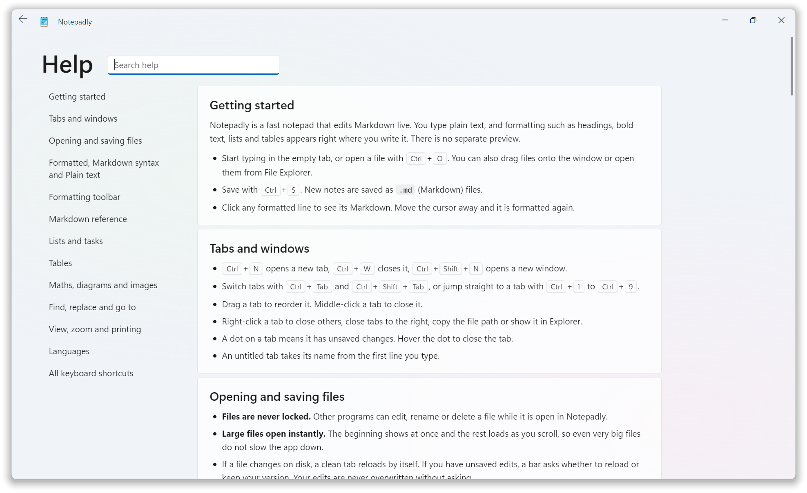

<div align="center">


# Notepadly

**The Windows 11 Notepad look, with a real live Markdown editor inside.**

Open a `.md` file and see headings, tables, maths, diagrams and callouts formatted as you type, in one pane, the way Obsidian's Live Preview works. Huge files open in about a second, and files are never locked.

[**Download for Windows**](../../releases/latest) · [See every feature](#features) · [Benchmarks](#benchmarks)

</div>



## Why Notepadly?

Windows Notepad is great for plain text. Open a Markdown file in it, though, and you get raw syntax. Notepadly keeps Notepad's look and feel and adds what Markdown writers need.



### At a glance

| | Windows Notepad | **Notepadly** |
| --- | :---: | :---: |
| Windows 11 look (Mica, tabs, menus) | ✅ | ✅ |
| Tabs, find and replace, zoom, word wrap, dark mode | ✅ | ✅ |
| Opens a **127 MB** Markdown file | **~28 s**, "Not Responding" for ~20 s | **content on screen in ~1 s** |
| Extra memory used by that 127 MB file | **+270 MB** | **+10 MB** |
| Markdown tables shown as real tables, edited in place | ❌ raw `\| pipes \|` | ✅ |
| Maths formulas (LaTeX / KaTeX) | ❌ | ✅ |
| Mermaid diagrams (flowcharts, sequence, pie…) | ❌ | ✅ |
| Callouts (`> [!note]`, 12 types, foldable) | ❌ | ✅ |
| Syntax-coloured code blocks | ❌ | ✅ **143 languages** |
| Images, footnotes, wikilinks, tags, comments, front matter | ❌ | ✅ |

The Notepad column shows what Windows Notepad displayed for the same `.md` file with its default settings (screenshots below).

## Benchmarks

All numbers were measured on the same PC, with the same file, one app at a time:

- **PC:** Intel Core i7-1355U, 24 GB RAM, Windows 11 Pro (build 26300), 150% display scale
- **Notepad:** version 11.2607.14.0
- **Test file:** 127 MB Markdown, made by repeating [`sample.md`](sample.md)

### Large files



| Opening a 127 MB Markdown file | Windows Notepad | **Notepadly** | |
| --- | ---: | ---: | --- |
| Time until the text is on screen | 28.4 s | **under 1 s** | **~28× faster** |
| Time the window is frozen ("Not Responding") | ~20 s | **0 s** | |
| Time until fully idle | ~28 s | **2–4 s** | |
| Memory with the file open | 357 MB | 259 MB | |
| Memory **added** by the file | +269 MB | **+10 MB** | **~27× less** |

Notepadly never reads a whole file at once. It shows the first 256 KB straight away and loads the rest in the background as you scroll, so file size barely changes its memory use.

### Everyday use

| | Windows Notepad | Notepadly |
| --- | ---: | ---: |
| Startup (window on screen, median of 5) | **200 ms** | 565 ms |
| Memory when idle, all processes | **88 MB** | 249 MB |
| Download size | built in | **4.3 MB** installer |

Notepad starts faster and uses less memory when idle, because Notepadly draws its window with Microsoft Edge WebView2. That cost stays flat, though: a 127 MB file adds only 10 MB to Notepadly, while the same file adds 269 MB to Notepad.

## Features

### 1. Live Markdown, in one pane

Formatting appears right where you type. Click a line and its Markdown marks appear so you can edit them; move away and the line is formatted again. There is no split screen and no separate preview.

You can also switch any tab between **Formatted**, **Markdown syntax** (all marks visible, still coloured) and **Plain text** from the status bar.

### 2. Tables that stay tables



Click any cell and edit it in place. <kbd>Tab</kbd>, <kbd>Enter</kbd> and the arrow keys move between cells, and a new row is added when you reach the end. Bold text, code, links, highlights and `<kbd>` keys all render inside cells. Column alignment (`:---:`) is respected.

### 3. Maths and diagrams



- **Maths:** inline `$E = mc^2$` and block `$$ … $$` formulas, rendered with KaTeX.
- **Mermaid:** flowcharts, sequence diagrams, pie charts and more, drawn from a ` ```mermaid ` block.
- Both stay rendered when you click them. Double-click (or use the edit button in the corner) to open the source.



### 4. Callouts



12 types (note, info, tip, success, question, warning, danger, bug, example, quote, summary, todo), each with its own colour and icon. Add `-` or `+` to make one foldable.

### 5. Code blocks with colours for 143 languages



Language grammars load only when a file needs them, so they cost nothing until used.

### 6. Everything else in Markdown

| Feature | Example |
| --- | --- |
| Headings, bold, italic, strikethrough, `==highlight==` | `# Title`, `**bold**`, `~~old~~` |
| Lists, numbered lists, task lists with clickable checkboxes | `- [ ] task` |
| Quotes, nested quotes | `> quote` |
| Links (<kbd>Ctrl</kbd>+click to open) and `[[wikilinks]]` | `[text](https://…)` |
| Images, with optional width | `` |
| Footnotes | `text[^1]` |
| Tags shown as pills | `#project/notepadly` |
| Comments, dimmed and left out of printing | `%% note to self %%` |
| Front matter | `---` YAML block at the top |
| Inline HTML: `<kbd>`, `<mark>`, `<sub>`, `<sup>`, `<u>`… | `<kbd>Ctrl</kbd>` |

Open [`sample.md`](sample.md) in Notepadly to see all of them.

### 7. Built for speed and safety

- **Never locks files:** each read and save opens the file, does its work and closes it. Other programs can edit, rename or delete a file while it is open.
- **Safe saves:** Notepadly writes to a temporary file, then swaps it in, so a crash never leaves a half-written file.
- **Reloads changed files:** a clean tab reloads when the file changes on disk. If you have unsaved edits, Notepadly asks first.
- **Restores your session:** unsaved notes and open tabs come back the next time you start the app.
- **Small:** a 6.6 MB app and a 4.3 MB installer.

### 8. The Notepad you know



- The Windows 11 Notepad title bar, tabs, menus, status bar and Mica background, in light and dark mode.
- Tabs, multiple windows, find and replace, go to line, zoom, word wrap, print and page setup, insert time and date (<kbd>F5</kbd>).
- Line endings (CRLF / LF) and encodings (UTF-8, UTF-16, ANSI), shown and changeable from the status bar.
- Every language and script, with right-to-left lines flowing from the right on their own.
- A searchable **Help** page (<kbd>F1</kbd>) that explains every feature and shortcut.

## Download

Get the latest installer or portable exe from the [**Releases**](../../releases/latest) page. Notepadly needs Windows 10 or 11 with the WebView2 runtime, which Windows 11 already includes.

## Development

Requirements: Node.js 22+, Rust (stable) and the WebView2 runtime.

```bash
npm install
npm run app:dev      # run with hot reload
npm run app:build    # build the exe and installer into src-tauri/target/release
npm run icons        # regenerate every icon file from src-tauri/icons/source/notepadly-icon.svg
```

Built with Tauri 2 (Rust), React 19, TypeScript and CodeMirror 6.

## Checks

Every pull request runs these checks automatically, each shown separately on the PR:

| Check | What it runs |
| --- | --- |
| Typecheck and build | `npm run build` (TypeScript + Vite) |
| Unit tests | `npm test` (Vitest) |
| Rust format | `cargo fmt --check` |
| Rust lint (clippy) | `cargo clippy -- -D warnings` |
| Rust tests | `cargo test --lib` |

Run them locally before pushing:

```bash
npm run build
npm test
cd src-tauri && cargo fmt --check && cargo clippy --lib --all-targets -- -D warnings && cargo test --lib
```

## Releasing a new version

Push a version tag. GitHub Actions builds the installer and a portable exe and publishes them as a release. The version comes from the tag.

```bash
git tag v0.2.0
git push origin v0.2.0
```

## License

Notepadly is **free and open source** under the [Apache License 2.0](LICENSE). You may use, copy, change, share and sell it, for personal or commercial use, without paying anything. Keep the [`LICENSE`](LICENSE) and [`NOTICE`](NOTICE) files with your copy, and mark the files you changed.

**The name and icon are not included.** "Notepadly" and the Notepadly icon belong to Hamza Javed. If you release a modified version, give it your own name and icon. [TRADEMARKS.md](TRADEMARKS.md) explains what is allowed.

**Clean implementation.** Notepadly was written from scratch. No code was copied from Windows Notepad, Obsidian or any other app, and no software was decompiled or reverse engineered; the Windows 11 look was recreated by observing the public interface. See [ORIGINALITY.md](ORIGINALITY.md). The open-source libraries it builds on are listed in [THIRD-PARTY-NOTICES.md](THIRD-PARTY-NOTICES.md).

Microsoft, Windows and Notepad are trademarks of Microsoft Corporation. Notepadly is not affiliated with Microsoft.
