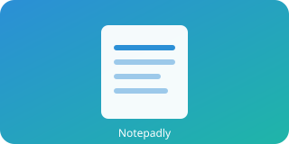
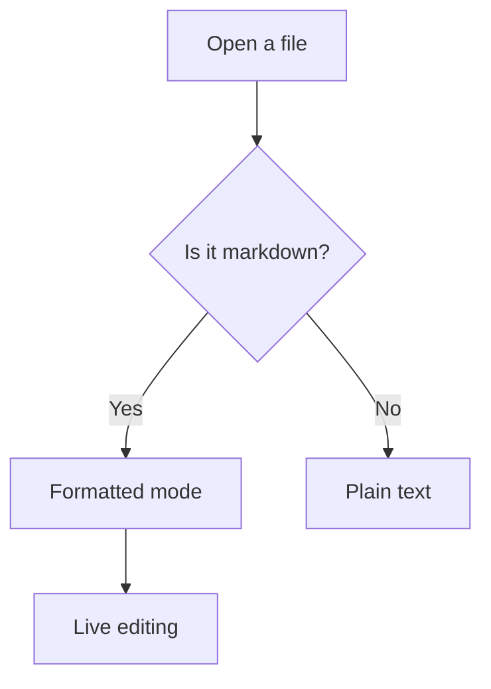
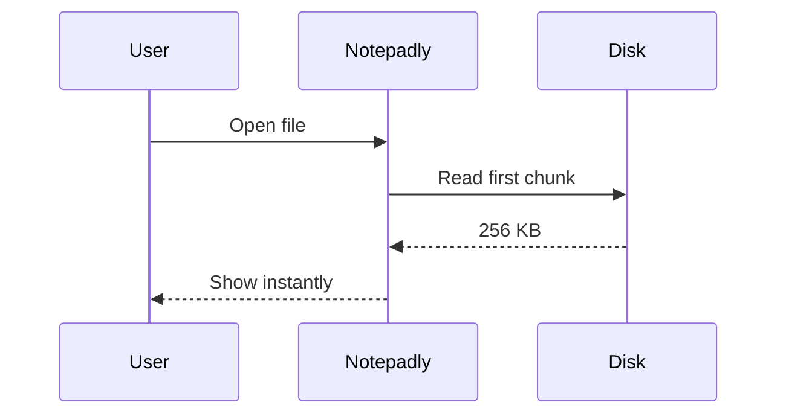
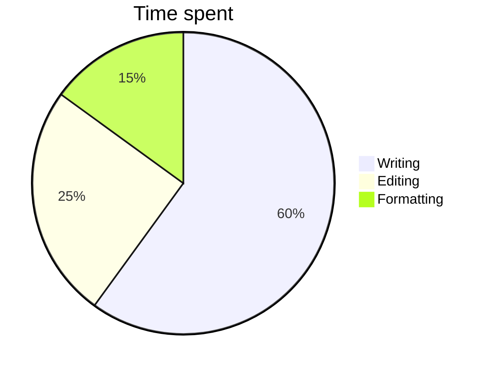

# Notepadly Markdown Sample

This file shows everything the Notepadly live editor supports. Click any line to see its markdown; move the cursor away and it renders again.

%% This is a comment. It shows dimmed in the editor and is left out when printing. %%

---

## 1. Headings

# Heading 1
## Heading 2
### Heading 3
#### Heading 4
##### Heading 5
###### Heading 6

Setext Heading 1
================

Setext Heading 2
----------------

## 2. Text formatting

- **Bold text** and __bold with underscores__
- *Italic text* and _italic with underscores_
- ***Bold and italic together***
- ~~Strikethrough~~
- ==Highlighted text==
- `Inline code`
- H<sub>2</sub>O (subscript) and x<sup>2</sup> (superscript)
- <u>Underline</u> and <kbd>Ctrl</kbd> + <kbd>S</kbd> (inline HTML)
- Escaped characters: \*not italic\*, \# not a heading, \[not a link\]

## 3. Links

- Inline link: [Example website](https://example.com)
- Link with a title: [Hover me](https://example.com "Link title")
- Autolink: <https://example.org>
- Bare URL: https://www.example.net
- Email: <hello@example.com>
- Reference link: [reference style link][ref1] and collapsed [ref1][]
- Wikilink: [[Another note]]
- Wikilink with alias: [[Another note|shown name]]
- Wikilink to a heading: [[Another note#Some heading]]

Ctrl + click opens a link.

[ref1]: https://example.com/reference "Reference title"

## 4. Images

Normal image (relative path):



Image with a width:


Obsidian style embed:

![[sample-image.svg|120]]

Note embed (shown as a pill): ![[Another note]]

Clicking an image keeps it rendered. Double-click to see its markdown.

## 5. Lists

### Bulleted list
- First item
- Second item
  - Nested item
    - Deeper nested item
- Third item

### Numbered list
1. First step
2. Second step
   1. Sub-step
   2. Another sub-step
3. Third step

### Task list
- [x] Finished task
- [ ] Open task
- [ ] Click the checkbox to tick it
  - [x] Nested task

Press Enter in a list to start the next item. Enter on an empty item ends the list. Tab / Shift+Tab indent and outdent.

## 6. Blockquotes

> This is a simple quote.
>
> > This is a nested quote.
> >
> > > And this is a third level.

## 7. Callouts

> [!note] Note
> This is a note callout. **Formatting** works inside it too.

> [!info]
> With no title, the callout type becomes the title.

> [!tip] Tip
> A useful hint goes here.

> [!success] Success
> The job is done.

> [!question] Question
> Any questions?

> [!warning] Warning
> Be careful!

> [!danger] Danger
> This is dangerous.

> [!bug] Bug
> There is a bug here.

> [!example] Example
> An example.

> [!quote] Quote
> "Simplicity is the soul of efficiency."

> [!abstract] Summary
> A short summary.

> [!todo] Todo
> Things to do.

> [!tip]- Folded callout (click the arrow)
> This body starts hidden. Click the arrow next to the title.

> [!note]+ Foldable but open
> This one is open but can be folded.

## 8. Horizontal rules

Three ways to draw a line:

---

***

___

## 9. Code

Inline: `const x = 42;`

```javascript
// JavaScript
function greet(name) {
  return `Hello, ${name}!`;
}
console.log(greet("Notepadly"));
```

```typescript
interface Note {
  title: string;
  tags: string[];
}
const note: Note = { title: "Sample", tags: ["demo"] };
```

```python
def fibonacci(n):
    a, b = 0, 1
    for _ in range(n):
        yield a
        a, b = b, a + b

print(list(fibonacci(10)))
```

```rust
fn main() {
    let words = vec!["fast", "light", "native"];
    for w in &words {
        println!("{w}");
    }
}
```

```json
{
  "name": "notepadly",
  "fast": true,
  "lockFiles": false
}
```

```css
.note {
  color: #005fb8;
  border-radius: 8px;
}
```

```bash
npm run app:build
```

```sql
SELECT title, updated_at FROM notes WHERE tag = 'demo' ORDER BY updated_at DESC;
```

    This is an indented code block (4 spaces).
    It can hold code too.

## 10. Tables

Click a table: it stays a table and the cell is edited in place. Move between cells with Tab, Enter and the arrow keys.

| Feature | Status | Notes |
| :------ | :----: | ----: |
| Live preview | ✅ | Like Obsidian |
| Tabs | ✅ | Many at once |
| File lock | ❌ | Never |
| **Bold** in a cell | `code` | [link](https://example.com) |
| ==highlight== | ~~strike~~ | *italic* |

Alignment: first column left, second centred, third right.

| Shortcut | Action |
| --- | --- |
| <kbd>Ctrl</kbd>+<kbd>N</kbd> | New tab |
| <kbd>Ctrl</kbd>+<kbd>O</kbd> | Open |
| <kbd>Ctrl</kbd>+<kbd>S</kbd> | Save |
| <kbd>Ctrl</kbd>+<kbd>F</kbd> | Find |
| <kbd>Ctrl</kbd>+<kbd>H</kbd> | Replace |
| <kbd>Ctrl</kbd>+<kbd>G</kbd> | Go to line |
| <kbd>Ctrl</kbd>+<kbd>B</kbd> | Bold |
| <kbd>Ctrl</kbd>+<kbd>I</kbd> | Italic |
| <kbd>Ctrl</kbd>+<kbd>K</kbd> | Link |
| <kbd>F5</kbd> | Time/Date |
| <kbd>Ctrl</kbd>+<kbd>Tab</kbd> | Next tab |
| <kbd>Ctrl</kbd>+<kbd>+</kbd> / <kbd>-</kbd> | Zoom |

## 11. Math (KaTeX)

Inline math: $E = mc^2$ and $a^2 + b^2 = c^2$. Prices like $5 and $10 stay plain text.

Block math (double-click to open the source):

$$
\int_0^1 x^2 \, dx = \frac{1}{3}
$$

$$
\sum_{n=1}^{\infty} \frac{1}{n^2} = \frac{\pi^2}{6}
$$

$$
\begin{bmatrix} 1 & 2 \\ 3 & 4 \end{bmatrix}
\begin{bmatrix} x \\ y \end{bmatrix}
=
\begin{bmatrix} 5 \\ 6 \end{bmatrix}
$$

## 12. Mermaid diagrams

Hover a diagram to see the edit button in its corner, or double-click it.







## 13. Footnotes

This sentence has a footnote[^1]. And this one has another[^note].

[^1]: Details of the first footnote.
[^note]: Footnote labels can be words too.

## 14. Tags

Tags show as pills: #markdown #notes #project/notepadly #2026

## 15. HTML

<details>
<summary>Click to expand</summary>

An HTML block shows as styled source.

</details>

<div align="center">Centred HTML div</div>

<!-- An HTML comment is dimmed too -->

## 16. Comments

Inline %%hidden comment%% in the middle of text.

%%
A block comment
across several lines
%%

## 17. Languages and scripts

Notepadly renders every script, and right-to-left lines flow from the right on their own.

### Right-to-left

- **Urdu:** یہ اردو کی ایک لائن ہے جو دائیں سے بائیں لکھی جاتی ہے۔
- **Arabic:** هذا سطر باللغة العربية يُكتب من اليمين إلى اليسار.
- **Persian:** این یک خط به زبان فارسی است.
- **Hebrew:** זוהי שורה בעברית שנכתבת מימין לשמאל.
- **Pashto:** دا په پښتو ژبه یوه کرښه ده.
- **Sindhi:** هي سنڌي ٻوليءَ ۾ هڪ سٽ آهي.

> اردو میں ایک اقتباس: **بولڈ**، *اٹالک* اور ==ہائی لائٹ== بھی چلتے ہیں۔

| زبان | مثال |
| --- | --- |
| اردو | خوش آمدید |
| العربية | أهلاً وسهلاً |

Mixed line: English text, then اردو الفاظ, then English again.

### South Asian scripts

- **Hindi:** यह हिंदी में एक पंक्ति है।
- **Bengali:** এটি বাংলায় একটি লাইন।
- **Punjabi (Gurmukhi):** ਇਹ ਪੰਜਾਬੀ ਵਿੱਚ ਇੱਕ ਲਾਈਨ ਹੈ।
- **Punjabi (Shahmukhi):** ایہہ پنجابی وچ اک لائن اے۔
- **Gujarati:** આ ગુજરાતીમાં એક લાઇન છે.
- **Marathi:** ही मराठीतील एक ओळ आहे.
- **Tamil:** இது தமிழில் ஒரு வரி.
- **Telugu:** ఇది తెలుగులో ఒక పంక్తి.
- **Kannada:** ಇದು ಕನ್ನಡದಲ್ಲಿ ಒಂದು ಸಾಲು.
- **Malayalam:** ഇത് മലയാളത്തിലെ ഒരു വരിയാണ്.
- **Sinhala:** මෙය සිංහලෙන් ලියූ පේළියකි.
- **Nepali:** यो नेपालीमा एउटा लाइन हो।

### East and Southeast Asian scripts

- **Chinese (Simplified):** 这是一行简体中文。
- **Chinese (Traditional):** 這是一行繁體中文。
- **Japanese:** これは日本語の一行です。カタカナとひらがなと漢字。
- **Korean:** 이것은 한국어로 된 한 줄입니다.
- **Thai:** นี่คือข้อความภาษาไทยหนึ่งบรรทัด
- **Vietnamese:** Đây là một dòng tiếng Việt.
- **Khmer:** នេះគឺជាបន្ទាត់មួយជាភាសាខ្មែរ។
- **Lao:** ນີ້ແມ່ນແຖວໜຶ່ງເປັນພາສາລາວ.
- **Burmese:** ဤသည်မှာ မြန်မာဘာသာဖြင့် စာကြောင်းတစ်ကြောင်းဖြစ်သည်။
- **Indonesian:** Ini adalah satu baris dalam bahasa Indonesia.

### European scripts

- **Spanish:** Esta es una línea en español. ¿Qué tal?
- **French:** Ceci est une ligne en français, avec des accents : é, è, ç, ô.
- **German:** Dies ist eine Zeile auf Deutsch. Größe, Übung, Straße.
- **Italian:** Questa è una riga in italiano.
- **Portuguese:** Esta é uma linha em português. Ação, coração.
- **Dutch:** Dit is een regel in het Nederlands.
- **Polish:** To jest linia po polsku. Zażółć gęślą jaźń.
- **Turkish:** Bu Türkçe bir satırdır. Çok güzel, İstanbul.
- **Swedish:** Det här är en rad på svenska. Åäö.
- **Russian:** Это строка на русском языке.
- **Ukrainian:** Це рядок українською мовою.
- **Serbian (Cyrillic):** Ово је ред на српском језику.
- **Greek:** Αυτή είναι μια γραμμή στα ελληνικά.
- **Armenian:** Սա հայերեն տող է։
- **Georgian:** ეს არის ხაზი ქართულ ენაზე.

### African and other scripts

- **Amharic:** ይህ በአማርኛ የተጻፈ መስመር ነው።
- **Swahili:** Huu ni mstari kwa Kiswahili.
- **Yoruba:** Èyí jẹ́ ìlà kan ní èdè Yorùbá.
- **Tibetan:** འདི་ནི་བོད་ཡིག་གི་ཐིག་ཅིག་ཡིན།
- **Mongolian (Cyrillic):** Энэ бол монгол хэл дээрх мөр юм.

### Symbols and emoji

- Emoji: 😀 🎉 🚀 ❤️ 👍🏽 🇵🇰 🇯🇵 🇩🇪 👨‍👩‍👧‍👦
- Arrows and maths: ← → ↑ ↓ ⇄ ∑ ∏ √ ∞ ≈ ≠ ≤ ≥ ∈ ∀ ∃
- Currency: $ € £ ¥ ₹ ₨ ₩ ₽ ₺ ₿
- Box drawing: ┌─┬─┐ │ │ │ └─┴─┘

## 18. Line breaks

Two spaces at the end of a line  
start a new line.

A backslash at the end\
also breaks the line.

---

*This sample ships with Notepadly. Edit it and try things out; if anything breaks, press Ctrl+Z.*
